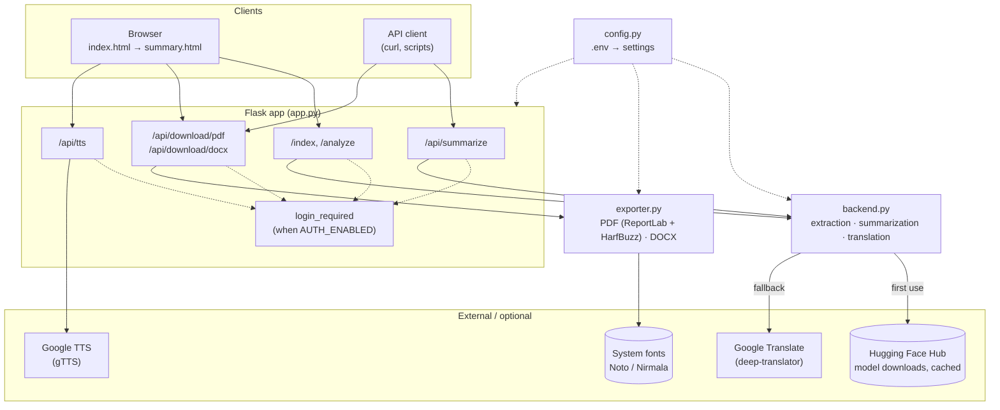
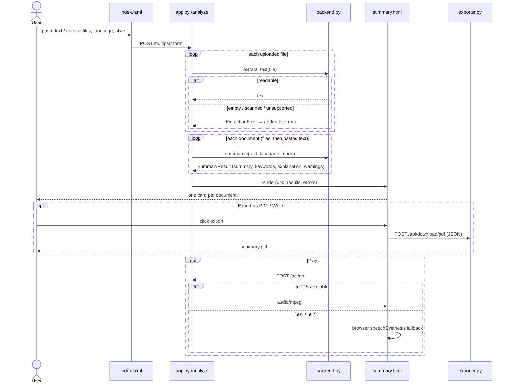
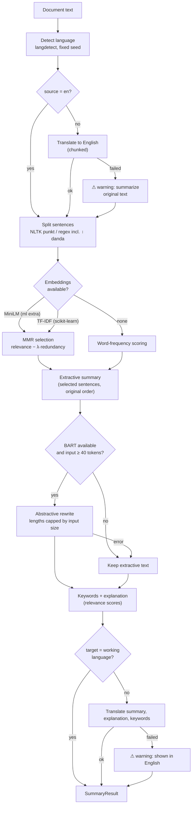
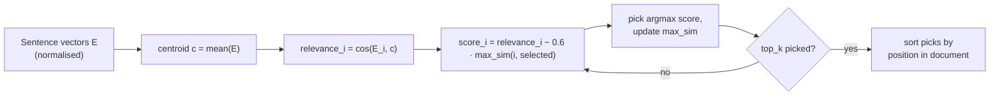
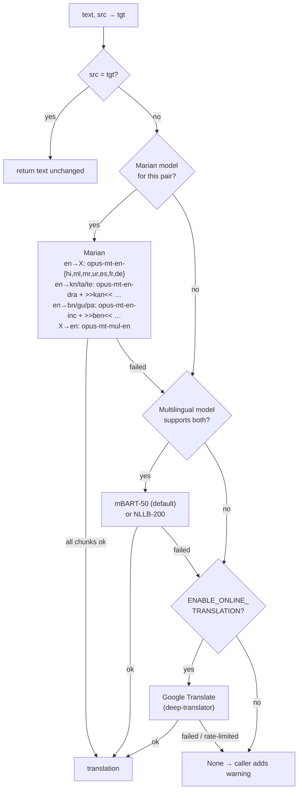
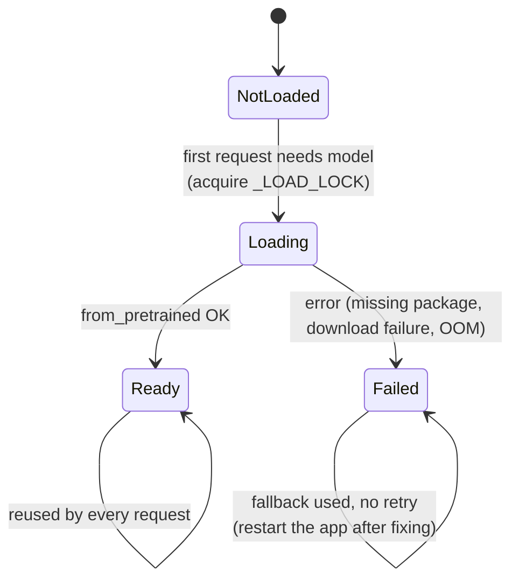
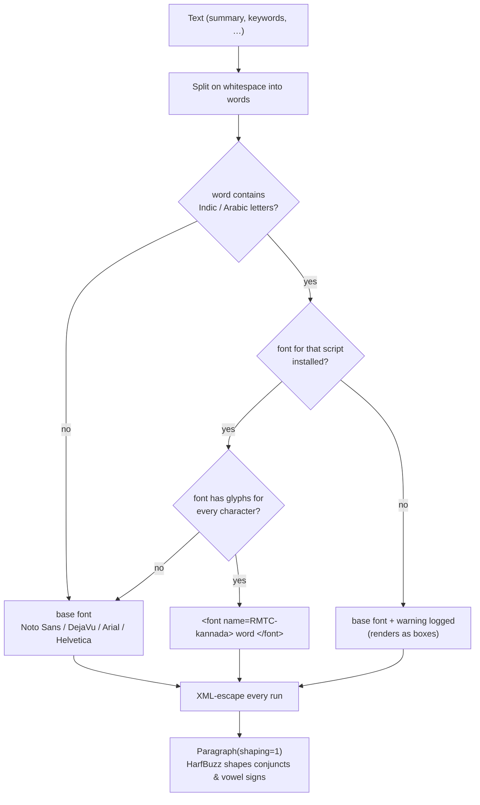
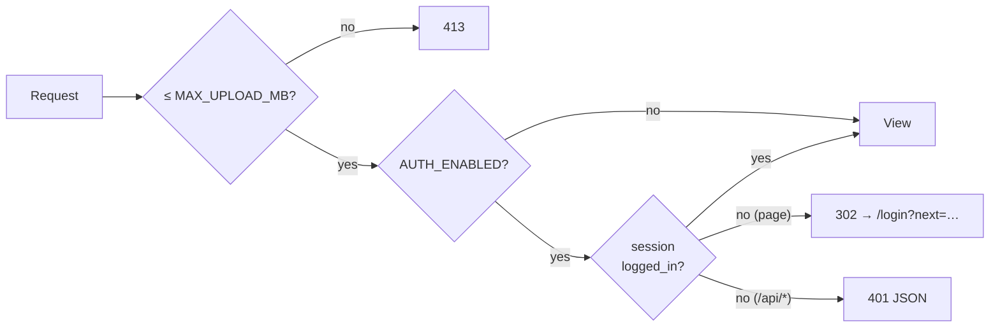

# Architecture

## System overview

| Module | Responsibility |
|---|---|
| `config.py` | Loads `.env` and exposes typed settings. Imported first by `app.py`. |
| `app.py` | Flask routes, optional authentication, upload handling, error responses. |
| `backend.py` | Text extraction, language detection, sentence selection, abstractive rewriting, translation. |
| `exporter.py` | PDF (ReportLab) and Word (python-docx) generation. |
| `templates/` | Server-rendered pages (Jinja2, Bootstrap 4). |

---

## Request lifecycle

How a form submission with two uploaded files becomes a results page:

`/api/summarize` follows the same path but returns JSON (see [API.md](API.md)).

---

## Summarization pipeline (`backend.summarize`)

Step by step:

1. **Language detection.** `langdetect` runs with a fixed seed so results are deterministic.
   Short Latin-script text (< 200 characters) is assumed to be English, because langdetect is
   unreliable on short snippets. Low-confidence results (< 0.85) also default to English.
2. **Translate to English** if needed. The summarizer and keyword extraction assume English.
   If translation fails, the pipeline continues on the original text and adds a warning.
3. **Sentence split.** NLTK `punkt`, or a regex fallback that also splits on the Devanagari danda (।).
4. **Embedding.** `paraphrase-multilingual-MiniLM-L12-v2`, falling back to TF-IDF. Vectors are L2-normalised.
5. **Selection** (see [MMR](#sentence-selection-mmr) below). The number of sentences picked (`top_k`)
   depends on the mode and the document length, and is about 50% higher for non-English output.
6. **Abstractive rewrite.** `facebook/bart-large-cnn`. The mode's min/max lengths are upper
   bounds, capped by the input size (`_generation_lengths`) so BART is never forced to write
   more than it was given, which would make it hallucinate.
7. **Keywords.** Most frequent non-stopword words. **Explanation:** the selected sentences with
   their position and relevance score.
8. **Translate to the target language.** Keywords stay English, and are labelled as such, when
   their translation can't be aligned one-to-one.

The result is a `SummaryResult` with `summary`, `explanation`, `keywords`, `keywords_language`,
`source_language`, `method` (`hybrid` or `extractive`) and `warnings`.

### Summary modes

| Mode | Sentences selected | BART min / max tokens (upper bounds) | Beams | Length penalty |
|---|---|---|---|---|
| simple | 2–6 | 20 / 120 | 2 | 2.0 |
| balanced | 3–8 | 60 / 300 | 4 | 1.0 |
| detailed | 6–12 | 120 / 400 | 6 | 0.8 |

### Sentence selection (MMR)

Maximal Marginal Relevance picks sentences that are close to the document's
overall meaning but not repetitive:

It is fully deterministic and vectorised with NumPy: one similarity matrix, then
O(k·n) work per document.

---

## Translation (`backend._translate_text`)

Each backend translates the **whole text in chunks**: sentences are grouped up to
400 tokens for models, or 4,500 characters for Google. Line and paragraph breaks are
kept as separate chunks so layout survives. If any chunk fails, the next backend is
tried for the whole text.

| Language | English → language (Marian) | mBART-50 | NLLB-200 |
|---|---|---|---|
| Kannada `kn` | `opus-mt-en-dra` `>>kan<<` | ✗ | `kan_Knda` |
| Tamil `ta` / Telugu `te` | `opus-mt-en-dra` `>>tam<<` / `>>tel<<` | ✓ | ✓ |
| Malayalam `ml` | `opus-mt-en-ml` | ✓ | ✓ |
| Hindi `hi` / Marathi `mr` / Urdu `ur` | `opus-mt-en-{hi,mr,ur}` | ✓ | ✓ |
| Bengali `bn` / Gujarati `gu` | `opus-mt-en-inc` `>>ben<<` / `>>guj<<` | ✓ | ✓ |
| Punjabi `pa` | `opus-mt-en-inc` `>>pan_Guru<<` | ✗ | `pan_Guru` |
| Spanish / French / German | `opus-mt-en-{es,fr,de}` | ✓ | ✓ |
| any → English | `opus-mt-mul-en` | ✓ (listed languages) | ✓ |

---

## Model loading, caching and concurrency

- Models load lazily and are cached per process. With `LIGHTWEIGHT_MODE=true` they are never loaded.
- `_LOAD_LOCK` stops concurrent first requests from loading the same multi-GB model twice.
- The multilingual tokenizer's `src_lang` is shared state, so setting it and encoding happen under `_MULTI_LOCK`.
- Each WSGI worker process holds its own copy of the models. Size the worker count to your RAM or GPU.

---

## PDF export and Indic scripts

ReportLab's built-in fonts cover only Latin-1, so `exporter.py` picks fonts itself:

- Fonts are found by indexing TTF files in `PDF_FONT_DIR`, `./fonts` and the OS font folders.
  Per script it looks for Noto Sans *Script*, then Nirmala UI, then the old Windows fonts (Tunga, Mangal, Latha …), then Lohit.
- Fonts are switched per **word**, not per character, because ReportLab can't shape a word
  whose characters span two fonts. A word like `(ಕನ್ನಡ)` is drawn entirely in the Kannada font,
  which includes the brackets.
- All user text is XML-escaped before ReportLab's markup parser sees it.
- Right-to-left (Urdu) text is right-aligned, but word order needs `rlbidi`, which isn't on PyPI.
  Word export handles Urdu correctly.

---

## Security model

- Passwords are checked against a Werkzeug hash (`APP_PASSWORD_HASH`), and the username is compared in
  constant time. After login, `next` only redirects to local paths, which blocks open redirects.
- `FLASK_SECRET_KEY` must be set for stable, unforgeable sessions. Without it a random key is generated per start.
- Templates rely on Jinja autoescaping. Per-document data reaches JavaScript only through a
  `tojson` JSON block, never through inline event-handler strings.
- CDN assets (Bootstrap, jQuery, Popper) are pinned with Subresource Integrity hashes.
- Online translation and TTS send text to Google. Disable them for confidential data.
